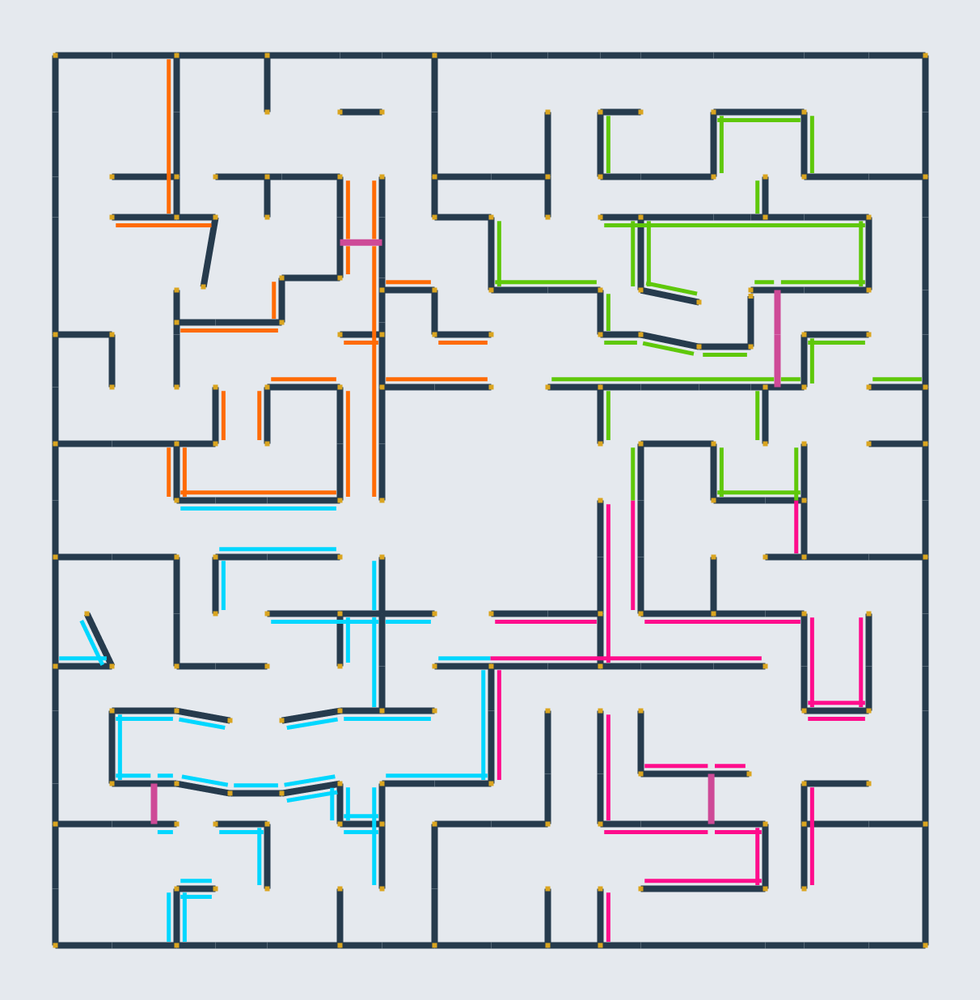

# MirrorMaze

Version 0.2.1. Built with [ArgonSDK](https://github.com/Chiv2-Community/ArgonSDK) (Unreal Engine 4.25). Requires [MirrorKit](https://github.com/SageFlare/MirrorKit) 0.7.0 or later.

## Installation

MirrorMaze needs both PAKs:

- `MirrorMaze.pak` (this map)
- `MirrorKit.pak` (the mirrors; see the [MirrorKit releases](https://github.com/SageFlare/MirrorKit/releases))

Copy both into `Chivalry 2/TBL/Content/Paks/` and launch through the [Unchained Launcher](https://github.com/Chiv2-Community/UnchainedLauncher). 

## Mirror quality

The map uses MirrorKit's settings for mirror-heavy maps (the same as its `High` preset). You can change them for your own game with a launch option, for example `-MirrorQuality=Low` or `-MirrorQuality=Ultra`, and server hosts can set values for everyone, or an optional cap, in the map options. See [Mirror quality in the MirrorKit README](https://github.com/SageFlare/MirrorKit#mirror-quality).

## License

Original MirrorMaze work is licensed under the MIT License. See `LICENSE` and `THIRD_PARTY_NOTICES.md`.
